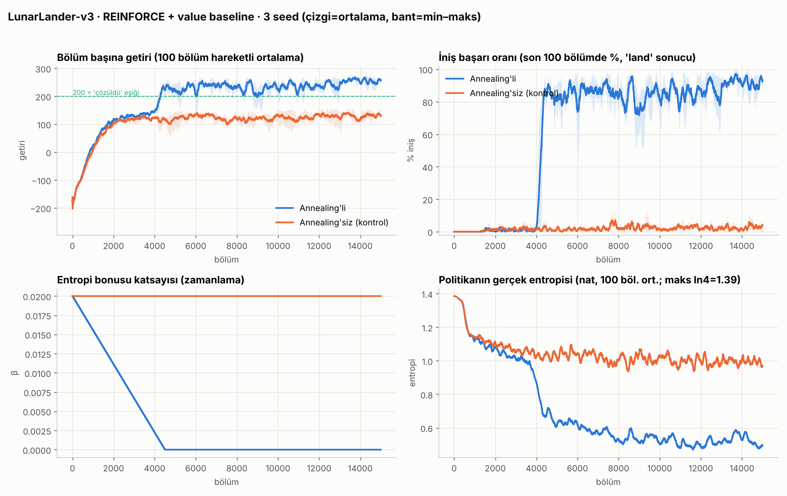
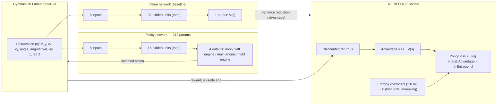

# LunarLander REINFORCE

A tiny 212-parameter policy network learning to land in Gymnasium's `LunarLander-v3` the hard way: it crashes in every one of the first ~500 episodes, then gets stuck in a "hovering" local optimum (full throttle until timeout), and only escapes it once entropy annealing (decaying the exploration bonus to zero over training) is introduced — landing success goes from **0%** to **~91%**.

> Inspiration: the Lunar Lander + REINFORCE post by [@gettheia_extension](https://www.instagram.com/gettheia_extension/) on Instagram. This repo is an independent, from-scratch reimplementation of that idea.

## Contents
- [Story: from crashing to landing](#story-from-crashing-to-landing)
- [Architecture](#architecture)
- [Results](#results-annealing-vs-control)
- [Code layout](#code-layout)
- [Setup and usage](#setup-and-usage)
- [References](#references)

## Story: from crashing to landing

With a randomly initialized policy the agent has no idea what to do: landing success is **0%** for roughly the first 500 episodes. A control run trained with a *fixed* entropy bonus quickly settles into a "safe" local optimum: keep firing the engine and hover until the episode times out, since that looks less bad than risking a crash (-100 reward). Over the last 500 episodes the control group's landing rate is still only about **3%**.

A second run anneals the entropy coefficient linearly to zero over the first 30% of training. The extra exploration early on is enough to escape the hovering trap, and once annealing ends the learned landing behavior locks in: averaged over 3 seeds, the landing rate over the last 500 episodes reaches **91.1%**.



*(Image lives at `runs/karsilastirma.png`; regenerate with `python visualize.py compare --runs runs` if missing.)*

A recorded "learning story" replay is at `runs/ogrenme_hikayesi_anneal_s1.mp4` (produced via `python visualize.py replay --run runs/anneal_s1 --save ...`, stepping through saved checkpoints).

## Architecture



## Model / algorithm summary

| Component | Detail |
|---|---|
| Environment | Gymnasium `LunarLander-v3` (discrete, 4 actions, 8-dim observation) |
| Policy network | 8 → 16 (tanh) → 4 logits, **212 parameters**, output layer initialized small (gain=0.1) so the starting policy is ~uniform / high entropy |
| Baseline | Separate small `ValueNet`: 8 → 32 (tanh) → 1, used as advantage = G − V(s) for variance reduction |
| Algorithm | REINFORCE (Monte-Carlo policy gradient) + value baseline + entropy bonus |
| Entropy annealing | β: `ent_start=0.02` → decays linearly to 0 over the first 30% of training, then stays at 0 |
| Discount (γ) | 0.99 |
| Learning rate | Policy 1e-2, value 1e-2 (Adam) |
| Batch | 8 episodes per update |
| Training signal | A `time_penalty=0.1` per-step penalty is added **only to the training signal** — the logged return is the raw Gymnasium reward |
| Outcome classes | `land` (episode ended with +100), `hover` (1000-step timeout), `crash` (impact/out-of-bounds, -100) |

## Results (annealing vs control)

3 seeds (0, 1, 2), 15,000 episodes, from the actual run logs (`runs/ozet.json`, `runs/ozet.txt`):

| Metric | Annealing | Control (fixed β) |
|---|---|---|
| Landing rate, first 500 episodes | 0.0% | 0.0% |
| Landing rate, 500 episodes just before annealing ends | 60.1% (avg) | — |
| **Landing rate, last 500 episodes** | **91.1%** | **3.0%** |
| Average return, last 500 episodes | 252.9 | 131.8 |
| Best single-episode return (max across 3 seeds) | ~337.5 | ~276.6 |

Per-seed detail is in `runs/ozet.txt` — e.g. `anneal_s1` reaches a 94.8% landing rate over its last 500 episodes, while `control_s0` stays at 2.6%. Control episodes also run systematically longer (hovering to timeout), so total environment steps end up roughly 2x higher than the annealed runs.

## Code layout

| File | Contents |
|---|---|
| `policy.py` | `PolicyNet` (8→16 tanh→4, 212 params) and `ValueNet` (baseline), plus a numpy/torch forward-pass equivalence check |
| `reinforce.py` | `Config`, `Trainer`: rollout, discounted return, REINFORCE + entropy-annealing update, logging/checkpointing |
| `train.py` | CLI entry point: launches annealing + control runs (multi-seed, multi-process), produces the summary and comparison plot |
| `visualize.py` | Live viewer window, "learning story" checkpoint replay (with video export), comparison plot |
| `runs/` | Run outputs: per-run `config.json`, `log.csv`, `ckpt/` (weight checkpoints); at the root, `ozet.json`, `ozet.txt`, `karsilastirma.png`, a sample video |

## Setup and usage

```bash
pip install -r requirements.txt
# or, in one line:
pip install torch "gymnasium[box2d]" numpy matplotlib imageio imageio-ffmpeg
```

```bash
python policy.py                                    # verifies the 212-parameter count
python train.py --quick                             # quick 300-episode smoke test (runs_quick/)
python train.py --seeds 0 1 2                        # full training: annealing + control, 15000 episodes
python train.py --live                               # live window during training
python visualize.py replay --run runs/anneal_s1       # "learning story" window
python visualize.py replay --run runs/anneal_s1 --save story.mp4   # save it as video
python visualize.py watch --ckpt runs/anneal_s1/ckpt/final.pt        # watch a single model live
python visualize.py compare --runs runs               # regenerate the comparison plot
```

## References

| Source | Role | License |
|---|---|---|
| [Gymnasium](https://gymnasium.farama.org/) | RL environment API, `LunarLander-v3` | MIT |
| [PyTorch](https://pytorch.org/) | Autograd, optimization | BSD-3-Clause |
| [Box2D](https://box2d.org/) (`box2d-py` / `gymnasium[box2d]`) | `LunarLander` physics engine | zlib |

## License

[](LICENSE)

The code in this repository is released under the MIT License (`LICENSE`). Every dependency used (Gymnasium: MIT, PyTorch: BSD-3-Clause, Box2D: zlib) is permissive; this repo does not vendor their source, only depends on them.
