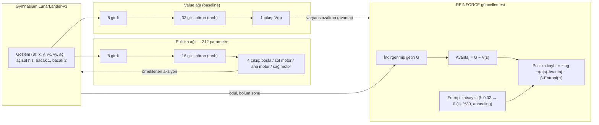

# LunarLander REINFORCE

212 parametrelik minik bir politika ağının, Gymnasium'un `LunarLander-v3` ortamında inişi "düşünmeden" öğrenmesi: ilk 500 denemede tamamen çakılıyor, sonra motoru tam gaz tutup havada asılı kalan ("hovering") bir yerel optimuma sıkışıyor — ve entropi annealing (merak katsayısının eğitim boyunca sıfıra indirilmesi) devreye girince iniş başarısı ilk denemelerdeki **%0'dan ~%91'e** çıkıyor.

> Esinlenme: Instagram'da [@gettheia_extension](https://www.instagram.com/gettheia_extension/) hesabının Lunar Lander + REINFORCE paylaşımı. Bu depo o fikrin sıfırdan, kendi koduyla yeniden üretimidir.

## İçindekiler
- [Hikaye: çakılmadan inişe](#hikaye-çakılmadan-inişe)
- [Mimari](#mimari)
- [Sonuçlar](#sonuçlar-annealing-vs-kontrol)
- [Kod yapısı](#kod-yapısı)
- [Kurulum ve çalıştırma](#kurulum-ve-çalıştırma)
- [Kaynakça](#kaynakça)

## Hikaye: çakılmadan inişe

Politika rastgele başlatıldığında ajan ne yaptığını bilmiyor: ilk ~500 bölümde iniş başarısı **%0**. Sabit (annealing'siz) bir entropi bonusuyla eğitilen kontrol grubu kısa sürede "güvenli" bir yerel optimuma kilitleniyor: motoru sürekli yakıp havada asılı kalmak (zaman aşımına kadar "hover"), çünkü çarpmanın (-100) riskini almaktansa beklemek daha az kötü görünüyor. Son 500 bölümde kontrol grubunun iniş oranı hâlâ **%3** civarında kalıyor.

Entropi katsayısını eğitimin ilk %30'unda doğrusal olarak 0'a indiren (annealing) sürüm ise erken aşamada daha fazla keşif yapmaya zorlanıyor, "hover" tuzağından çıkıyor ve annealing bittiğinde kazanılan davranışı sağlamlaştırıyor: son 500 bölümde iniş oranı 3 tohum (seed) ortalamasında **%91,1**'e çıkıyor.


*(Görsel `runs/karsilastirma.png` içinde; yoksa `python visualize.py compare --runs runs` ile yeniden üretilebilir.)*

Öğrenme sürecinin video kaydı: `runs/ogrenme_hikayesi_anneal_s1.mp4` (checkpoint'lerle "öğrenme hikayesi" replay'i, `python visualize.py replay --run runs/anneal_s1 --save ...` ile üretildi).

## Mimari



## Model / algoritma özeti

| Bileşen | Detay |
|---|---|
| Ortam | Gymnasium `LunarLander-v3` (discrete, 4 aksiyon, 8 boyutlu gözlem) |
| Politika ağı | 8 → 16 (tanh) → 4 logit, **212 parametre**, çıkış katmanı küçük başlatılır (gain=0.1) → başlangıçta ~uniform/yüksek entropi |
| Baseline | Ayrı küçük `ValueNet`: 8 → 32 (tanh) → 1, varyansı azaltmak için avantaj = G − V(s) |
| Algoritma | REINFORCE (Monte-Carlo policy gradient) + value baseline + entropi bonusu |
| Entropi annealing | β: `ent_start=0.02` → eğitimin ilk %30'unda doğrusal olarak 0'a iner, sonra 0'da kalır |
| İndirim (γ) | 0.99 |
| Öğrenme oranı | Politika 1e-2, value 1e-2 (Adam) |
| Batch | Güncelleme başına 8 bölüm |
| Eğitim sinyali | Adım başına `time_penalty=0.1` cezası eklenir (**yalnızca eğitim sinyalinde** — loglanan getiri ham Gymnasium ödülüdür) |
| Sonuç sınıfları | `land` (bölüm +100 ile bitti), `hover` (1000 adım zaman aşımı), `crash` (çarpma/ekran dışı, -100) |

## Sonuçlar (annealing vs kontrol)

3 tohum (seed 0, 1, 2), 15.000 bölüm, gerçek koşu kayıtlarından (`runs/ozet.json`, `runs/ozet.txt`):

| Metrik | Annealing'li | Kontrol (sabit β) |
|---|---|---|
| İlk 500 bölüm iniş oranı | %0,0 | %0,0 |
| Annealing bitiminden önceki 500 bölüm iniş oranı | %60,1 (ortalama) | — |
| **Son 500 bölüm iniş oranı** | **%91,1** | **%3,0** |
| Son 500 bölüm ortalama getiri | 252,9 | 131,8 |
| En iyi tek bölüm getirisi (3 seed arası en yüksek) | ~337,5 | ~276,6 |

Tohum bazında ayrıntı `runs/ozet.txt` dosyasında: örneğin `anneal_s1` son 500 bölümde %94,8 iniş oranına, `control_s0` ise %2,6'da kalıyor. Kontrol grubunun bölümleri de sistematik olarak daha uzun sürüyor (zaman aşımına kadar havada kalma), bu yüzden toplam adım sayısı annealing'li koşulardan ~2x fazla.

## Kod yapısı

| Dosya | İçerik |
|---|---|
| `policy.py` | `PolicyNet` (8→16 tanh→4, 212 parametre) ve `ValueNet` (baseline), numpy/torch ileri geçiş eşleşme testi |
| `reinforce.py` | `Config`, `Trainer`: rollout, indirgenmiş getiri, REINFORCE + entropi annealing güncellemesi, log/checkpoint yazımı |
| `train.py` | Komut satırı girişi: annealing'li + kontrol koşularını (çok seed, çok süreç) başlatır, özet ve karşılaştırma grafiği üretir |
| `visualize.py` | Canlı izleme penceresi, checkpoint'lerle "öğrenme hikayesi" replay'i (video kaydı dahil), karşılaştırma grafiği |
| `runs/` | Koşu çıktıları: her koşu için `config.json`, `log.csv`, `ckpt/` (ağırlık checkpoint'leri); kök dizinde `ozet.json`, `ozet.txt`, `karsilastirma.png`, örnek video |

## Kurulum ve çalıştırma

```bash
pip install -r requirements.txt
# veya tek satır:
pip install torch "gymnasium[box2d]" numpy matplotlib imageio imageio-ffmpeg
```

```bash
python policy.py                                   # 212 parametreyi doğrular
python train.py --quick                             # 300 bölümlük hızlı test (runs_quick/)
python train.py --seeds 0 1 2                        # tam eğitim: annealing + kontrol, 15000 bölüm
python train.py --live                               # eğitim sırasında canlı pencere
python visualize.py replay --run runs/anneal_s1       # "öğrenme hikayesi" penceresi
python visualize.py replay --run runs/anneal_s1 --save hikaye.mp4   # videoya kaydet
python visualize.py watch --ckpt runs/anneal_s1/ckpt/final.pt        # tek modeli canlı izle
python visualize.py compare --runs runs               # karşılaştırma grafiğini yeniden çiz
```

## Kaynakça / References

| Kaynak | Rolü | Lisans |
|---|---|---|
| [Gymnasium](https://gymnasium.farama.org/) | RL ortam API'si, `LunarLander-v3` | MIT |
| [PyTorch](https://pytorch.org/) | Otomatik türev, optimizasyon | BSD-3-Clause |
| [Box2D](https://box2d.org/) (`box2d-py` / `gymnasium[box2d]`) | `LunarLander` fizik motoru | zlib |

## Lisans

[](LICENSE)

Bu depodaki kod MIT lisansı ile yayınlanmıştır (`LICENSE`). Kullanılan kütüphaneler (Gymnasium: MIT, PyTorch: BSD-3-Clause, Box2D: zlib) hepsi izin verici lisanslardır; bu depo onların kaynak kodunu içermez, sadece bağımlılık olarak kullanır.
